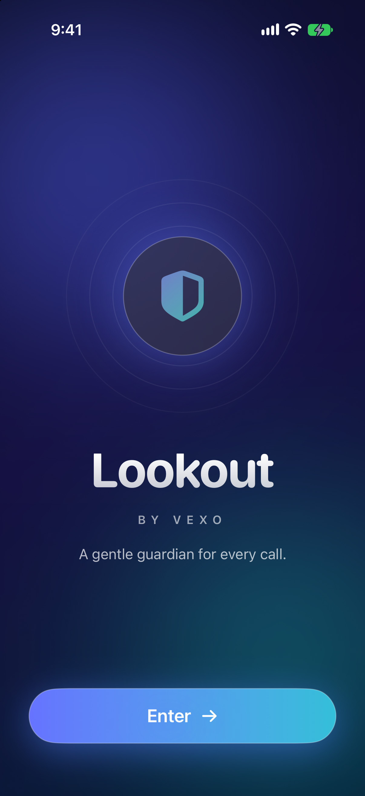
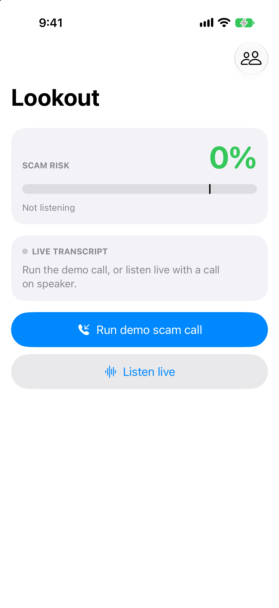
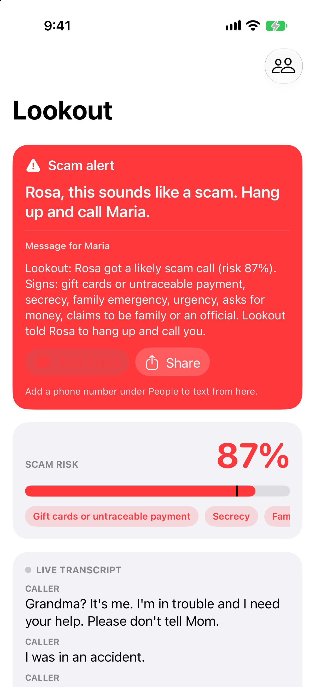
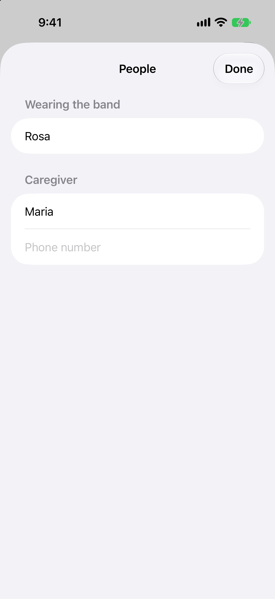

<p align="center">
  
</p>

<p align="center">
  
  
  
  
  
</p>

<h3 align="center">A gentle guardian for every call.</h3>

<p align="center">
  <b>Lookout</b> listens to a phone call, spots the tell-tale signs of a scam as they happen,<br>
  steps in with a spoken warning, and lets a trusted caregiver know, all on the device.
</p>

---

## ✨ Screenshots

<table align="center">
  <tr>
    <td align="center"><br><sub><b>Welcome</b></sub></td>
    <td align="center"><br><sub><b>Ready to listen</b></sub></td>
    <td align="center"><br><sub><b>Scam alert fires</b></sub></td>
    <td align="center"><br><sub><b>Wearer &amp; caregiver</b></sub></td>
  </tr>
</table>

## 🤖 The agent loop

Lookout runs as a small autonomous agent. It doesn't wait to be asked. It watches the conversation and acts once the risk is high enough.

```
  🎙 LISTEN  ──▶  📊 SCORE  ──▶  ⚠️ INTERRUPT  ──▶  📲 ESCALATE
  live speech     scam markers    spoken warning     text the
  to text         → risk %        + haptics          caregiver
```

| Stage | What happens | Where |
| --- | --- | --- |
| **Listen** | Streams the mic into Apple's speech recognizer, on-device when supported, so the audio stays on the phone. | `LiveListener.swift` |
| **Score** | Each transcript update is checked against weighted scam markers. Risk = `1 − ∏(1 − weight)` over the distinct markers heard. | `ScamScorer.swift` |
| **Interrupt** | When risk crosses **80%**, Lookout plays a warning (*"Rosa, this sounds like a scam. Hang up and call Maria."*) and buzzes. | `LookoutEngine.swift` |
| **Escalate** | Writes a summary of the call for the caregiver, ready to send by SMS or the share sheet. | `ContentView.swift` |

### Scam markers it listens for

| Marker | Weight | Example phrases |
| --- | :---: | --- |
| Gift cards or untraceable payment | 0.45 | "gift cards", "wire transfer", "bitcoin", "zelle" |
| Asks for codes or account access | 0.40 | "verification code", "password", "remote access" |
| Keeps you on the line | 0.35 | "don't hang up", "stay on the phone" |
| Secrecy | 0.30 | "don't tell", "keep this between us" |
| Family emergency | 0.25 | "accident", "in jail", "bail", "hospital" |
| Urgency | 0.25 | "right now", "immediately", "hurry" |
| Asks for money | 0.25 | "send money", "thousand", "$" |
| Claims to be family or an official | 0.20 | "it's me", "your bank", "the IRS", "tech support" |

Phrases match on word boundaries, so *"available"* won't trigger *"bail"*. The scorer sits behind a `ScamScoring` protocol, so you can replace it with a model-backed scorer without touching the rest of the app.

## 🚀 Features

- **🎭 Demo scam call**: plays a scripted "grandparent scam" out loud and scores it line by line. Works in the Simulator.
- **🎧 Listen live**: put a real call on speaker and Lookout transcribes and scores it as it happens.
- **🔒 Private by design**: no network calls, no API keys, and on-device speech recognition when the device supports it.
- **👥 Personalized**: set the wearer's and caregiver's names and the caregiver's phone number under **People**.
- **💬 One-tap escalation**: text the caregiver a ready-made summary, or share it any other way.

## 🛠 Getting started

**Requirements:** Xcode 26 or later, iOS 26 or later

```bash
git clone https://github.com/coldrazer/lookout.git
cd lookout
open lookout.xcodeproj
```

1. Select an iPhone simulator or device and press **⌘R**.
2. Tap **Enter**, then **Run demo scam call** to watch the alert fire.
3. To try **Listen live** on a device, allow Microphone and Speech Recognition access when asked.

## 🗂 Project structure

```
lookout/
├── LookoutApp.swift     # App entry, startup → main transition
├── StartupView.swift    # Branded animated launch screen
├── ContentView.swift    # Risk meter, transcript, alert card, People sheet
├── LookoutEngine.swift  # The agent loop: listen → score → interrupt → escalate
├── LiveListener.swift   # Mic + SFSpeechRecognizer streaming transcription
├── ScamScorer.swift     # Weighted keyword scam scorer (ScamScoring protocol)
└── scam_alert.wav       # Pre-recorded spoken warning
```

## 🧭 Roadmap

- [ ] Wearable band integration (replaces the phone mic in `LiveListener`)
- [ ] On-device LLM scorer behind `ScamScoring`
- [ ] Automatic caregiver notification
- [ ] Localization beyond English

## 📄 License

Released under the [Apache License 2.0](LICENSE).

<p align="center"><sub>Built with ❤️ by <b>Vexo</b> · Lookout keeps an eye out, so you don't have to.</sub></p>
